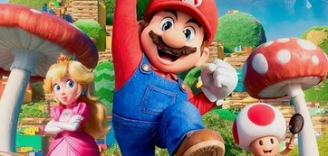

# Игра Супер Марио

| Приветствуем в стране супер марио! |
|:---:|
|  |

За основу взят код игры с youtube канала "Begin End":  

1. [Первая часть](https://www.youtube.com/watch?v=7sTPrktLLBo&list=PLBOPkQsFLCR2DWRY74L03FmbRtz_Yy73_&index=30)
2. [Вторая часть](https://www.youtube.com/watch?v=8QDgZ3GNlt8&list=PLBOPkQsFLCR2DWRY74L03FmbRtz_Yy73_&index=34)


## История

1981 год. Nintendo of America находилась на грани краха, и тогда Сигэру Миямото 
разработал игру о противостоянии гориллы и маленького прыгающего человечка. 
Это была знаменитая Donkey Kong, которая положила начало карьере пухлого водопроводчика 
по имени Марио. С тех пор он появился более чем в двух сотнях игр, принес компании 
миллиардную прибыль и стал более узнаваемым, чем Микки-Маус.  


## Принципы, на основе которых написана игра?

1. Логика независима от визуального представления. Применяется архитектурный принцип **MVC**.

2. Приложение **кроссплатформенное**: логика не зависит от ОС.

3. Логика работает не с множествами объектов, а с множествами абстракций.

4. Для написания логики игры используется **полиморфизм**.

5. В игре применяются паттерны проектирования: 
	**Singleton**, **Factory**, **Adapter**, **Iterator**.


## Управление клавиатурой

В консоли windows (cmd) через `#include <windows.h>` можно читать состояние клавиш. 
Терминал linux работает по старым принципам телетайпа 1960-х гг. Он был создан для работы 
с последовательным портом, где нет понятия "клавиша нажата/отжата" — есть только поток символов. 
Поэтому для linux я решил изменить механику управления:

- Windows:
	- `A` - движение влево
	- `D` - движение вправо
	- `Space` - прыжок
	- `Q` - выход из программы
	
- Linux:
	- `A` - движение влево
	- `D` - движение вправо
	- `S` - остановиться
	- `Space` - прыжок
	- `Q` - выход из программы


## 📝 Задания для самостоятельной работы

1. Изучить наследование на примере построения диаграмм иерархий для классов: 
	ConsoleEnemy, ConsoleShip.  
   
2. Изучить создание и хранение объектов игры на примере классов: 
	ConsoleUIFactory, Game.  

3. Создать:
	- летающего врага;
	- прыгающего на месте врага;
	- передвигающуюся платформу, на которую марио может запрыгнуть и переместиться 
		по карте над морем.

4. Изучить архитектуру построения уровней. Сделать новый второй уровень 
	и создать третий уровень.

5. Внимательно изучить весь код и подготовить ответы на вопросы.

6. Изучить, как построена кроссплатформенность в приложении. 

На данный момент кроссплатформенность не является серьёзной проблемой и для всего 
существуют кросплатформенные библиотеки, но сам принцип построения архитектуры 
приложений продолжает оставаться актуальным.  

7. 🎯 Создать уровень, который не сможет пройти преподаватель.


## Дополнительные материалы

1. Александр Цвец: "Погружение в паттерны проектирования". 
	Книга и карта ПП лежит в папке `docs/`.  

2. Сайт [https://refactoring.guru/ru/](https://refactoring.guru/ru/), на котором 
	эта же книга описана в виде статей, но расширена примерами кода на всех языках 
	программирования. Работает с **V\*\*N**.  

⚠️ **Ресурсы 1. и 2. украинские**, но материал по паттернам проектирования 
представлен очень хорошо. И найти такого же качества материал непросто. Главное - 
не покупайте ничего на представленном сайте и не ведите никакой переписки. 
Бесплатного материала там хватит с головой.  


## Новые объекты и уровни (домашнее задание)

| Символ | Объект |
|:---:|---|
| `@` | Марио |
| `e` | ходящий враг |
| `f` | летающий враг (`FlyingEnemy`): летит по прямой влево-вправо |
| `j` | прыгающий на месте враг (`JumpingEnemy`) |
| `=` | движущаяся платформа (`MovingPlatform`): Марио на ней едет вместе с ней |
| `#` | корабль |
| `?` | коробка с монеткой |
| `$` | монетка |

Прыжок сверху убивает любого врага: +50 очков. Монета: +100 очков. Счёт показан вверху экрана (`Score: N`);
при смерти очки текущего уровня сгорают. Бегать и прыгать можно одновременно.
На движущейся платформе Марио стоит на месте, а карта едет под ним (интерфейс `Carrier`).

Уровни: 1 (оригинальный), 2 «Над морем», 3 «Рывок», 4 «Экзамен» (финальный, очень сложный).
Финишем уровня считается **последний созданный static-объект** (корабль, коробка, платформа).


## Версия на Qt (графика на спрайтах)

Та же игра, тот же игровой цикл и контроллер, но вместо консоли окно Qt со спрайтами.
Всё, что относится к Qt, лежит в `src/ui/qt/` (отрисовка) и `src/os_controls/qt/` (клавиатура).
Платформа выбирается в одном месте, в `main.cpp`, одним блоком `#if`: он задаёт `PlatformAppFactory`.
Дальше `main` работает только с абстрактной `AppFactory` (папка `src/app/`), которая создаёт настройки консоли,
клавиатуру, фабрику объектов и задержку кадра: `WindowsAppFactory`, `LinuxAppFactory`, `QtAppFactory`.

Сборка и запуск (Windows, MSYS2 UCRT64 с Qt6):

```
build_qt.bat
run_qt.bat
```

Linux (нужны `qt6-base-dev`, `cmake`, `ninja-build`):

```
sudo apt install qt6-base-dev cmake ninja-build
chmod +x build_qt.sh
./build_qt.sh
./build_qt_ninja/super_mario
```

Управление: `A` / `D` или стрелки влево/вправо, `Space` или стрелка вверх (прыжок), `Q` или `Esc` (выход).
Работает и с русской раскладкой. Бег и прыжок можно нажимать одновременно.

Как устроено:

| Что | Класс |
|---|---|
| Клавиатура через Qt | `QtKeyboard` (реализует `KeyBoard`, ловит события через `eventFilter`) |
| Создание окна приложения | `QtControlSettings` (реализует `OSControlSettings`) |
| Фабрика объектов | `QtUIFactory` (реализует `UIFactory`) |
| Карта | `QtGameMap` (реализует `GameMap`: `refresh()` рисует кадр в `QImage`, `show()` выводит его в окно) |
| Окно | `QtGameView` |
| Объекты | `QtMario`, `QtEnemy`, `QtFlyingEnemy`, `QtJumpingEnemy`, `QtMoney`, `QtShip`, `QtBox`, `QtFullBox`, `QtMovingPlatform` |

Размеры берутся из спрайтов, а не растягиваются: одна клетка модели равна 16 пикселям (`qt_metrics.hpp`).
Одиночные объекты (Марио, враги, монета, блок с `?`) рисуются спрайтом фиксированного размера,
протяжённые (земля, кирпичи, платформа, вода) собираются из повторяющихся плиток 16x16.
Спрайты лежат в `src/ui/qt/sprites/` и вшиваются в программу через `sprites.qrc`:
чтобы заменить картинку, подмените PNG и пересоберите.
Окно показывает первые 90 клеток карты (`QT_MAX_VISIBLE_COLS`), размер окна можно менять.
